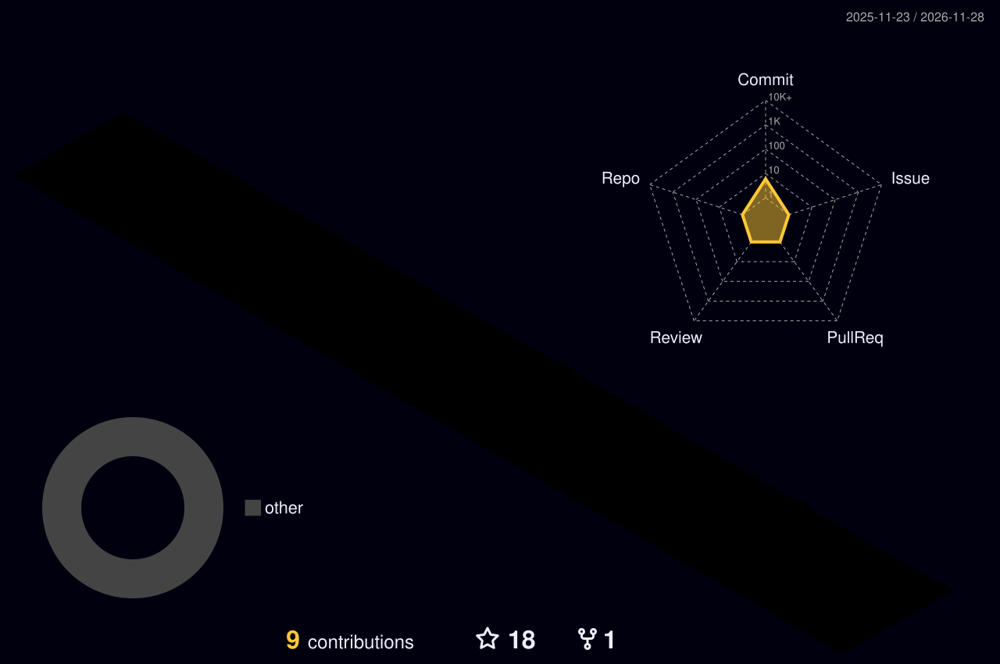

  

# Hi, I'm Ayush Kumar Mishra 👋

I'm a developer interested in web development, problem solving, and open source. I enjoy learning by building useful projects and collaborating with others.

## About me

- 🌱 Exploring web development and data structures & algorithms.
- 🤝 Open to collaborating on interesting and useful projects.
- 💬 Happy to talk about technology, problem solving, and curious questions.
- 📫 Reach me by email or LinkedIn using the links above.

## Technologies

**Languages and web:**

**Tools and platforms:**

## GitHub activity

  

  

  

## Find me online

- [GitHub](https://github.com/CODEPANDA-1122)
- [LinkedIn](https://www.linkedin.com/in/ayushkmishra97/)
- [Email](mailto:ayuhkmishra30@gmail.com)

---

⭐ Thanks for visiting my profile!
